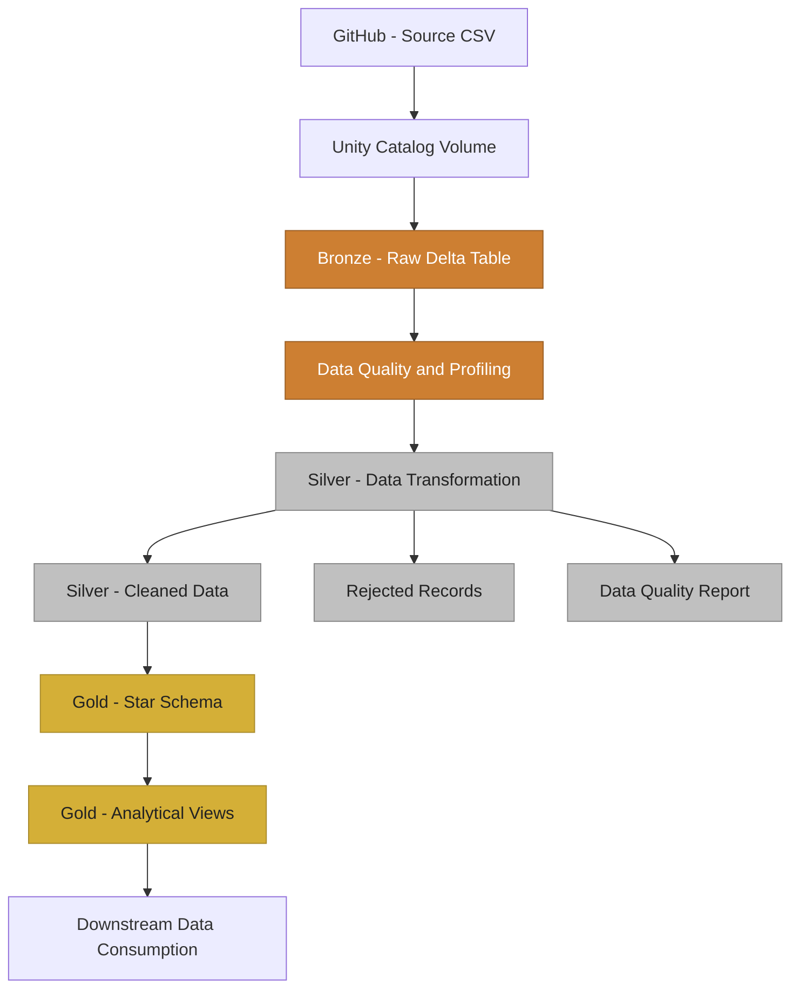
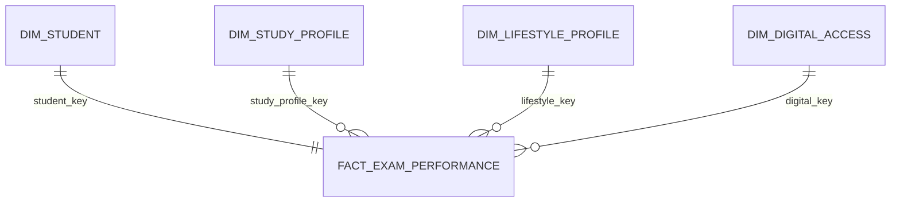
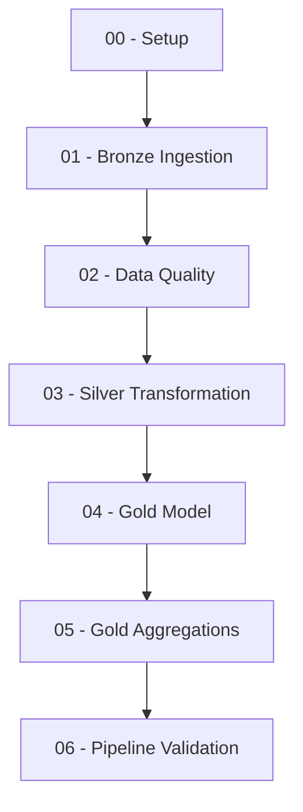
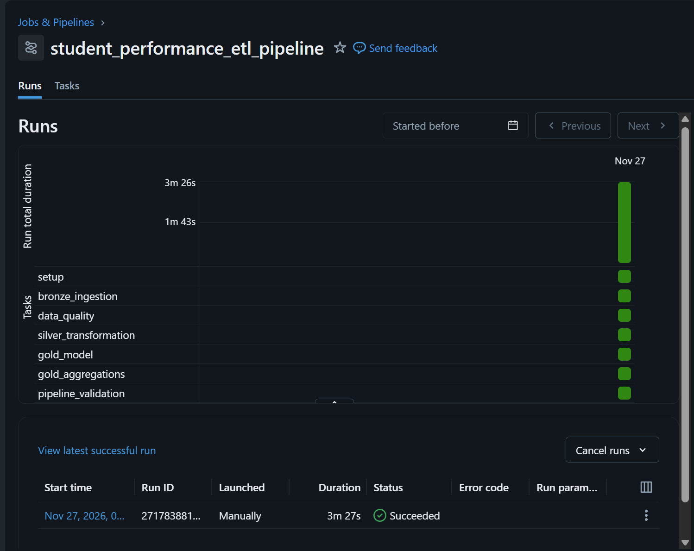

# Student Exam Performance – Data Engineering Pipeline


## Project Overview

An end-to-end data engineering pipeline built using
Databricks, Apache Spark and Delta Lake.

The project implements the Medallion Architecture,
transforming raw student exam performance data into
a validated dimensional data model and analytical views.

The project was developed as part of the Big Data
course at the University of Warsaw.


## Project Highlights

- End-to-end ETL pipeline
- Medallion Architecture (Bronze, Silver, Gold)
- Distributed data processing with Apache Spark
- Data cleaning and feature engineering with PySpark
- Delta Lake tables and Unity Catalog
- Dimensional modelling using a Star Schema
- SQL-based analytical views
- Automated data quality and integrity checks
- Pipeline orchestration with Databricks Lakeflow Jobs
- Reproducible notebook-based implementation

## Dataset

**Student Exam Performance and Success Dataset**

[Source dataset on Kaggle](https://www.kaggle.com/datasets/mobeenfatimah/student-exam-performance-and-success-dataset)

| Property | Value |
|---|---|
| Records | 100,000 |
| Source attributes | 44 |
| Source format | CSV |
| Processing type | Batch |
| Data granularity | One observation per student |

The dataset includes demographic information,
socioeconomic characteristics, study habits,
lifestyle factors, digital access and exam results.

The dataset is semi-synthetic and is used
for educational purposes.

## Technology Stack

| Technology | Purpose |
|---|---|
| Databricks Free Edition | Data engineering platform |
| Apache Spark | Distributed data processing |
| PySpark | Data cleaning and transformation |
| Spark SQL | Data modelling and aggregation |
| Delta Lake | Data storage |
| Unity Catalog | Data organization |
| Lakeflow Jobs | Pipeline orchestration |
| GitHub | Version control and documentation |

## Data Architecture



### Bronze Layer

`workspace.student_bronze`

Responsible for raw data ingestion and preservation
of source data.

- Source CSV download
- Unity Catalog Volume storage
- Raw Delta table creation
- Ingestion metadata

### Silver Layer

`workspace.student_silver`

Responsible for data cleaning, standardization
and validation.

- Data type conversion
- Missing value handling
- Duplicate detection
- Business rule validation
- Rejected record management
- Feature engineering
- Data quality reporting

### Gold Layer

`workspace.student_gold`

Responsible for dimensional modelling and
analytical data serving.

- One fact table
- Four dimension tables
- Eight analytical SQL views
- Deterministic key generation
- Referential integrity validation

## Dimensional Data Model

The Gold layer implements a Star Schema.



| Table | Type |
|---|---|
| fact_exam_performance | Fact |
| dim_student | Dimension |
| dim_study_profile | Dimension |
| dim_lifestyle_profile | Dimension |
| dim_digital_access | Dimension |

The grain of the fact table is one student exam
observation.

## Pipeline Orchestration

The ETL pipeline is orchestrated using Databricks
Lakeflow Jobs.

Job name: `student_performance_etl_pipeline`



Each task depends on the successful completion
of its preceding task.

The pipeline uses manual triggering because
the source dataset is static.

### Execution Results

| Metric | Result |
|---|---|
| Execution status | Succeeded |
| Execution date | November 27, 2026 |
| Execution time | 3m 27s |
| Completed tasks | 7/7 |
| Source records | 100,000 |



## Data Quality and Validation

The pipeline includes automated checks for:

- Non-empty source and target tables
- Row count consistency
- Duplicate identifiers
- Invalid data types and values
- Primary key uniqueness
- Referential integrity
- Analytical aggregation completeness

The final validation notebook raises an error
if its validation conditions are not satisfied.

## Repository Structure

```text
student-performance-big-data/
├── data/
│   └── raw/
├── notebooks/
│   ├── 00_setup.ipynb
│   ├── 01_bronze.ipynb
│   ├── 02_data_quality.ipynb
│   ├── 03_silver.ipynb
│   ├── 04_gold_model.ipynb
│   ├── 05_gold_aggregations.ipynb
│   └── 06_pipeline_validation.ipynb
├── orchestration/
│   ├── README.md
│   └── job_config.json
├── docs/
│   ├── architecture.md
│   └── images/
├── .gitignore
└── README.md
```

## How to Run

1. Create a Databricks workspace.
2. Clone or download this repository.
3. Import the notebooks into Databricks.
4. Verify the source data URL and catalog configuration.
5. Configure a Lakeflow Job using the provided JSON
   configuration or create the tasks manually.
6. Adjust notebook paths to match your workspace.
7. Run the pipeline.
8. Verify that all validation checks pass.

Alternatively, execute the notebooks manually
in numerical order.

## Documentation

- [Technical Architecture](docs/architecture.md)
- [Notebook Documentation](notebooks/README.md)
- [Pipeline Orchestration](orchestration/README.md)
- [Job Configuration](orchestration/job_config.json)

## Project Status

- [x] Data ingestion
- [x] Medallion Architecture
- [x] Data quality and profiling
- [x] Data cleaning and transformation
- [x] Feature engineering
- [x] Dimensional modelling
- [x] Analytical views
- [x] Pipeline orchestration
- [x] Automated pipeline validation
- [x] Successful end-to-end execution
- [x] Technical documentation

## Scope and Limitations

This repository focuses exclusively on the
data engineering component of the project.

Data visualization, statistical analysis and
interpretation of results are outside its scope.

The implementation uses a static dataset and
Databricks Free Edition. Production-scale
performance and deployment in other environments
have not been validated.

## Author

**Filip Bancerz**

Data Engineering and Architecture

University of Warsaw
Data Science and Business Analytics

## Academic Purpose

This project was created for educational purposes
as part of the Big Data course.

Dataset usage is subject to the original dataset
license and distribution terms.

