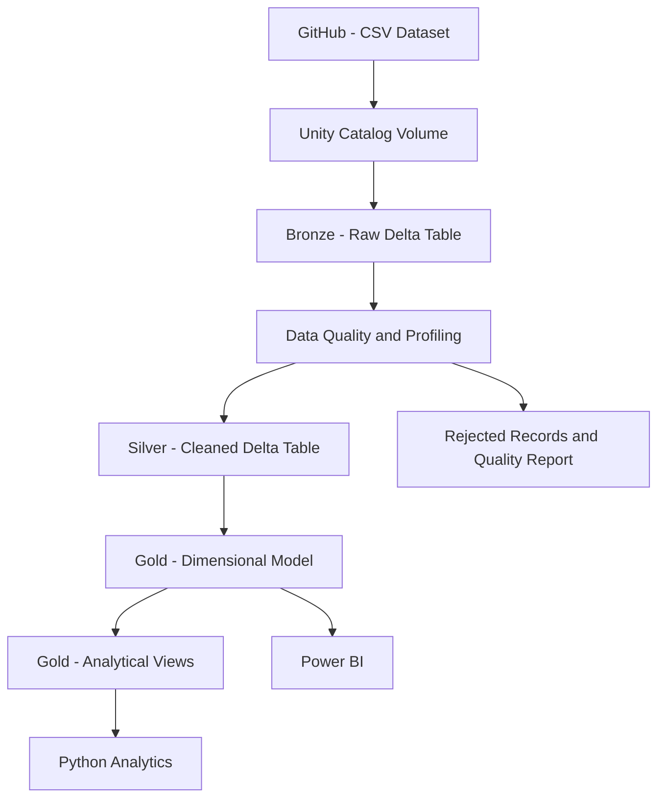
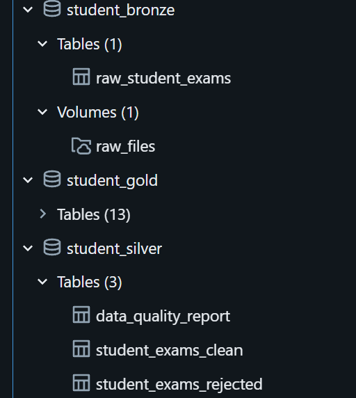
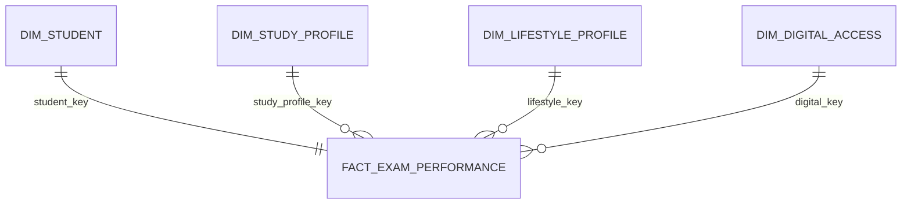
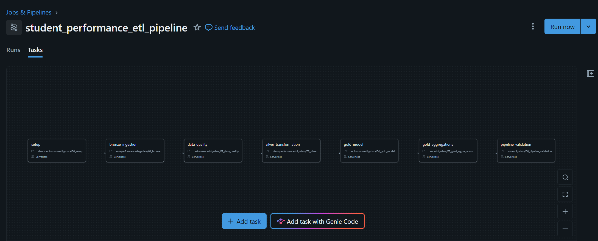
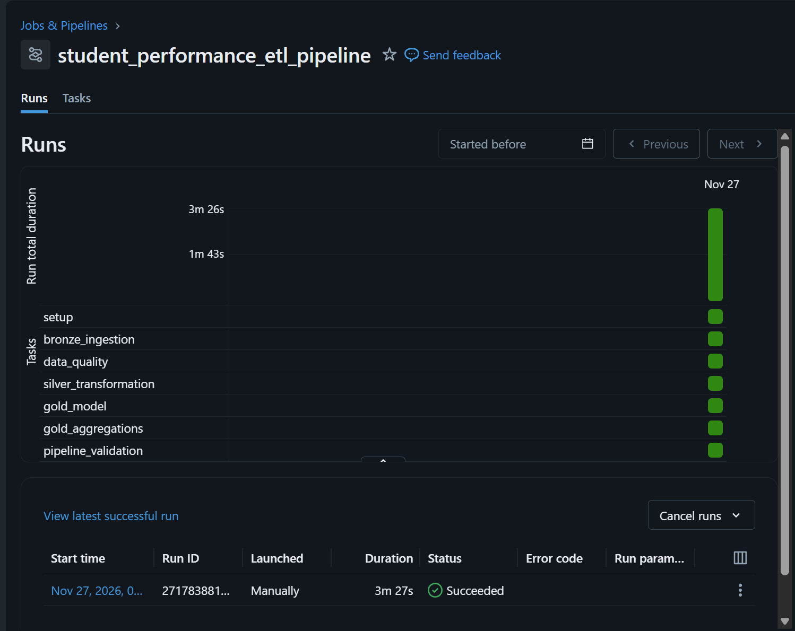

# Data Architecture

## 1. Architecture Overview

The project implements an end-to-end batch data engineering
pipeline using Databricks, Apache Spark, Delta Lake and
the Medallion Architecture.

The architecture separates raw data ingestion, data
transformation and analytical data serving into three
independent layers.



## 2. Source Data

The source dataset is the Student Exam Performance
and Success Dataset obtained from Kaggle.

The dataset contains 100,000 student observations
and 44 source attributes.

The source CSV file is stored in the GitHub repository
and downloaded into a Unity Catalog Volume.

## 3. Unity Catalog

All data objects are organized within the `workspace`
catalog using three dedicated schemas.

| Schema | Purpose |
|---|---|
| student_bronze | Raw data ingestion |
| student_silver | Data cleaning and validation |
| student_gold | Analytical data serving |



## 4. Bronze Layer

Schema: `workspace.student_bronze`

### Purpose

The Bronze layer preserves source data in its original
form and provides a starting point for downstream
transformations.

### Objects

| Object | Type | Description |
|---|---|---|
| raw_files | Volume | Source CSV storage |
| raw_student_exams | Delta table | Raw student data |

### Processing

- Source file download from GitHub
- Storage in Unity Catalog Volume
- CSV ingestion
- Preservation of source attributes
- Addition of ingestion metadata

## 5. Silver Layer

Schema: `workspace.student_silver`

### Purpose

The Silver layer provides cleaned, standardized and
validated data for downstream analytical processing.

### Objects

| Object | Type | Description |
|---|---|---|
| student_exams_clean | Delta table | Validated student records |
| student_exams_rejected | Delta table | Invalid records |
| data_quality_report | Delta table | Quality monitoring history |

### Transformations

- Data type conversion
- String normalization
- Missing value identification
- Duplicate detection
- Business rule validation
- Rejected record separation
- Feature engineering
- Data quality reporting

### Missing Value Strategy

Numerical missing values are preserved as nulls
to avoid introducing artificial observations.

Selected categorical missing values are replaced
with an Unknown category.

Missing value indicators are added for selected
attributes.

### Design Decision

A single primary Silver table is used because the
source dataset contains one observation per student.

Splitting the source into multiple tables with
one-to-one relationships would introduce additional
complexity without significant analytical benefits.

## 6. Gold Layer

Schema: `workspace.student_gold`

### Purpose

The Gold layer provides a dimensional data model
and analytical views for reporting and visualization.

### Dimensional Model

| Table | Role | Description |
|---|---|---|
| fact_exam_performance | Fact | Exam results and numerical measures |
| dim_student | Dimension | Student characteristics |
| dim_study_profile | Dimension | Study habits and methods |
| dim_lifestyle_profile | Dimension | Lifestyle characteristics |
| dim_digital_access | Dimension | Technology access and usage |

### Fact Table Grain

One record represents one student exam observation.

### Key Generation

Deterministic SHA-256 keys are generated from
student identifiers and combinations of dimension
attributes.

The same key generation logic is applied to both
fact and dimension tables.

### Star Schema



### Analytical Views

| View | Purpose |
|---|---|
| vw_student_performance | Unified analytical dataset |
| agg_academic_performance | Overall academic KPIs |
| agg_study_habits | Study time and methods |
| agg_lifestyle_impact | Sleep and stress analysis |
| agg_socioeconomic_factors | Socioeconomic analysis |
| agg_digital_learning | Technology and online learning |
| agg_exam_preparation | Exam preparation analysis |
| agg_grade_distribution | Grade distribution |

Standard SQL views are used to avoid storing
additional physical copies of aggregated data.

## 7. Pipeline Orchestration

The pipeline is orchestrated using Databricks
Lakeflow Jobs.

Job name: `student_performance_etl_pipeline`

The workflow consists of seven sequential tasks.



Each downstream task runs only after the successful
completion of its upstream dependency.

The job is manually triggered because the source
dataset is static.

The maximum number of concurrent job runs is one.

The exported job configuration is available in:

[Job configuration](../orchestration/job_config.json)

## 8. Data Quality and Validation

The pipeline includes automated checks for:

- Source and target table availability
- Non-empty datasets
- Row count consistency
- Duplicate identifiers
- Invalid data values
- Primary key uniqueness
- Referential integrity
- Analytical aggregation completeness

The final validation notebook raises an error
when its validation conditions are not satisfied.

## 9. Pipeline Execution

The pipeline was successfully executed on
November 27, 2026.

| Metric | Result |
|---|---|
| Execution status | Succeeded |
| Execution time | 3m 27s |
| Completed tasks | 7/7 |
| Source records | 100,000 |



## 10. Downstream Data Consumption

The Gold layer supports multiple analytical tools.

### Python

Python users can access the unified analytical
view and predefined aggregation views.

Example:

```python
df = spark.table(
    "workspace.student_gold.vw_student_performance"
)

display(df.limit(10))
```

### Power BI

The dimensional model is designed to support
Power BI reporting.

Data can be accessed through a compatible Databricks
SQL connection or exported to CSV or Parquet files.

Direct Power BI connectivity has not been validated
in the current Free Edition environment.

## 11. Design Considerations and Limitations

- The source dataset is static.
- The pipeline uses batch processing.
- Scheduled execution is not required.
- The dataset is semi-synthetic.
- Analytical relationships do not establish causality.
- Databricks Free Edition imposes compute limitations.
- Workspace paths must be adjusted when deploying
  the project in another environment.
- Full production-scale performance has not been tested.

## 12. Architecture Summary

| Component | Quantity |
|---|---|
| Unity Catalog schemas | 3 |
| Unity Catalog volumes | 1 |
| Bronze Delta tables | 1 |
| Silver Delta tables | 3 |
| Gold Delta tables | 5 |
| Gold SQL views | 8 |
| Pipeline notebooks | 7 |
| Orchestrated jobs | 1 |
