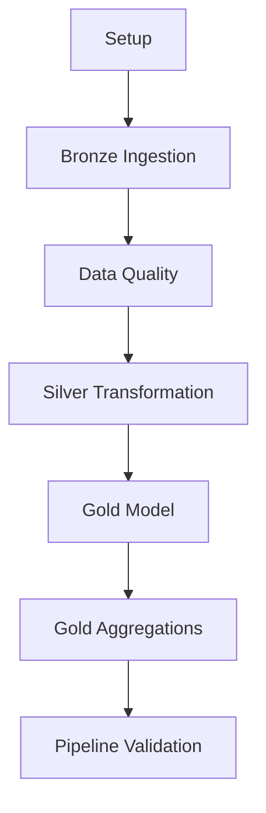

# Pipeline Orchestration

The data pipeline is orchestrated using Databricks Lakeflow Jobs.

## Job Configuration

- Job name: `student_performance_etl_pipeline`
- Compute: Serverless
- Trigger: Manual
- Execution mode: Sequential
- Number of tasks: 7

## Task Dependencies

| Task | Notebook | Depends on |
|---|---|---|
| setup | 00_setup | None |
| bronze_ingestion | 01_bronze | setup |
| data_quality | 02_data_quality | bronze_ingestion |
| silver_transformation | 03_silver | data_quality |
| gold_model | 04_gold_model | silver_transformation |
| gold_aggregations | 05_gold_aggregations | gold_model |
| pipeline_validation | 06_pipeline_validation | gold_aggregations |

## Pipeline DAG

Each task depends on the successful completion of the preceding task.

## Execution Results

| Metric | Result |
|---|---|
| Execution date | 2026-11-27 |
| Status | Succeeded |
| Duration | 3m 27s |
| Completed tasks | 7/7 |

## Scheduling Strategy

The pipeline is triggered manually because the source
dataset is static. Scheduled execution can be configured
if the source data becomes regularly updated.

## Reproducing the Pipeline

1. Import all notebooks into a Databricks workspace.
2. Create a Lakeflow Job.
3. Configure the seven notebook tasks.
4. Set the task dependencies as described above.
5. Adjust notebook paths to match the target workspace.
6. Run the job and verify the validation results.
